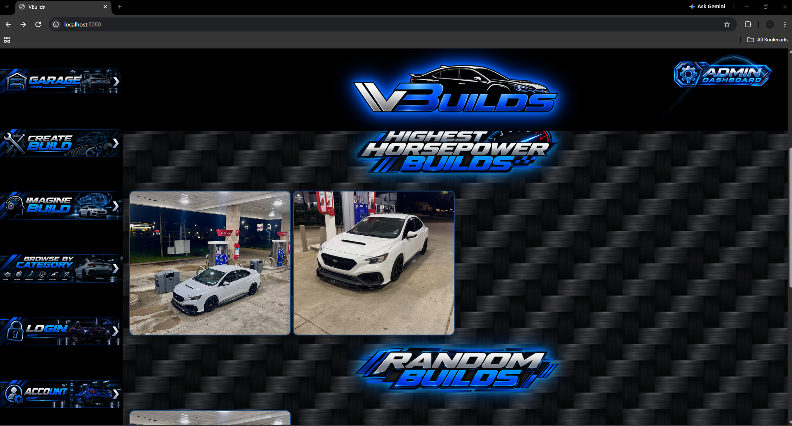
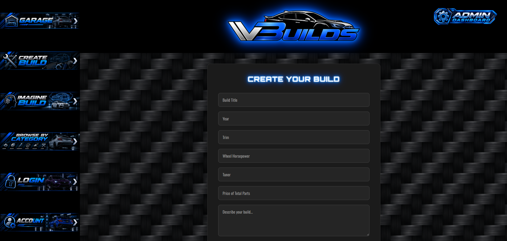
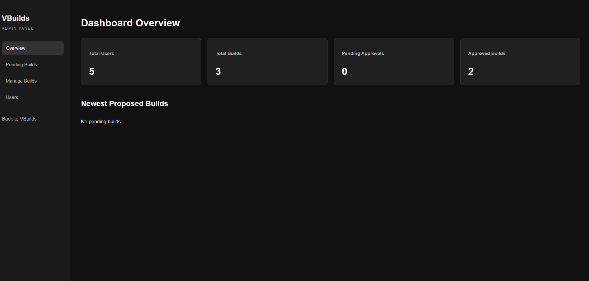
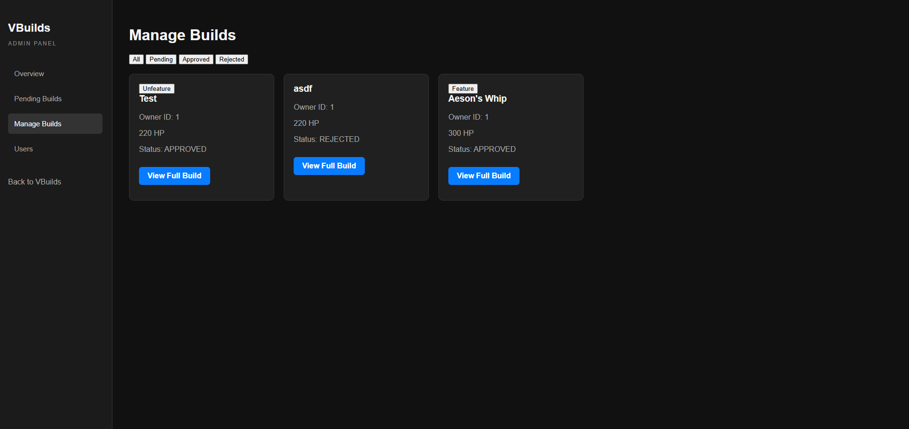

VBuilds

A full-stack automotive build-sharing platform built with Java, Spring Boot, PostgreSQL, JDBC, JavaScript, HTML, and CSS.


VBuilds lets automotive enthusiasts create and browse vehicle builds, upload photos, and manage their submissions.


It also includes an administrative interface for reviewing submissions, managing builds, and controlling featured content.


> **Status:** Active development. This is a portfolio project running locally; it is not currently a publicly hosted service. Some features and interfaces are still being refined.
Screenshots
Homepage and build discovery

Create a build

Admin dashboard

Build management

Features
Build discovery: Browse featured, newest, highest-horsepower, and random vehicle builds.

Build submissions: Enter vehicle specifications and descriptions and upload build photos.

User accounts: Register, log in, and view submitted builds and their approval statuses.

Authentication: Password hashing with BCrypt and session-based login.

Authorization: Admin-specific functions and ownership checks on build editing endpoints.

Moderation: Approve or reject submissions, manage builds, and mark builds as featured.

Admin overview: View summary counts for users, builds, and approvals.

## Tech Stack

| Layer | Technology |
|---|---|
| Backend | Java, Spring Boot, REST APIs |
| Database | PostgreSQL |
| Data Access | JDBC, prepared statements, DAO pattern |
| Frontend | HTML, CSS, vanilla JavaScript |
| Authentication | BCrypt, HTTP sessions |
| Build Tool | Maven |

## Architecture

The backend separates HTTP handling, application logic, and persistence:

```text

Browser (HTML / CSS / JavaScript)
            |
        REST API
            |
       Controllers
            |
        Services
            |
           DAOs
            |
       JDBC / SQL
            |
       PostgreSQL
```


## Running Locally

### Prerequisites

- Java JDK 17 or compatible
- Maven (or the included Maven wrapper)
- PostgreSQL

### Setup

1. Clone the repository.
2. Create a local PostgreSQL database named `VBBuilds` and configure the schema required by the application.
3. Configure the database connection in `Database.java`. The current implementation expects:
   - Host: `localhost:5432`
   - Database: `VBBuilds`
   - Username: `postgres`
   - Password: `PASSWORD` environment variable
4. Set the `PASSWORD` environment variable locally or in your IntelliJ run configuration. Never commit real credentials.
5. Start the Spring Boot application in IntelliJ or run:

```bash
./mvnw spring-boot:run
```

On Windows:

```powershell
.\mvnw.cmd spring-boot:run
```

6. Open `http://localhost:8080` in your browser.

**Note:** A reproducible database schema/setup script is not yet included. These are developer-oriented setup notes rather than a verified one-command installation guide.

## Development Roadmap

- Complete and polish the build-editing frontend.
- Improve local setup documentation and add database initialization scripts.
- Expand build-sharing functionality and improve responsive layouts.
- Explore AI-assisted build visualization as a future feature.

## Project Context

VBuilds is an independently developed portfolio project created to practice full-stack software engineering, REST API design, relational databases, session management, and role-based application workflows.
